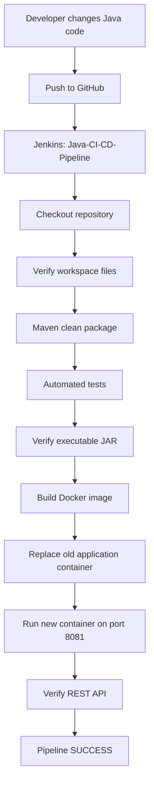

# Java CI/CD Pipeline with Jenkins, Maven, Docker, and Spring Boot

A containerized Java REST API demonstrating an automated Continuous Integration and Continuous Deployment (CI/CD) workflow using **Jenkins**, **Maven**, **Docker**, **Spring Boot**, and **GitHub**.

The pipeline checks out source code, builds and tests the application, verifies the packaged JAR, builds a Docker image, deploys the application container, and checks the deployed REST API.

> **Verified result:** Jenkins job `Java-CI-CD-Pipeline` completed with `Finished: SUCCESS`. Maven reported **5 tests, 0 failures, and 0 errors**, and the deployed API returned the seeded employee records.

## Table of Contents

1. [Objectives](#1-objectives)
2. [Technology Stack](#2-technology-stack)
3. [Architecture and Workflow](#3-architecture-and-workflow)
4. [Application Features](#4-application-features)
5. [Project Structure](#5-project-structure)
6. [Prerequisites](#6-prerequisites)
7. [Run Locally](#7-run-locally)
8. [Build and Test with Maven](#8-build-and-test-with-maven)
9. [Build and Test with Gradle](#9-build-and-test-with-gradle)
10. [Docker Build and Deployment](#10-docker-build-and-deployment)
11. [Git and GitHub Commands](#11-git-and-github-commands)
12. [Jenkins Setup](#12-jenkins-setup)
13. [Pipeline Stages](#13-pipeline-stages)
14. [API Endpoints](#14-api-endpoints)
15. [Verification Commands](#15-verification-commands)
16. [Troubleshooting](#16-troubleshooting)
17. [Demo and Submission Checklist](#17-demo-and-submission-checklist)
18. [Future Enhancements](#18-future-enhancements)

## 1. Objectives

This project automates the software delivery lifecycle:

1. Store the Java application in GitHub.
2. Check out the source code using Jenkins.
3. Compile and test the application using Maven.
4. Verify the executable JAR.
5. Build a Docker image.
6. Deploy the application in a Docker container.
7. Verify the deployed REST API.

The Jenkins job for this project is **`Java-CI-CD-Pipeline`**. The existing job **`Employee-Management-CI-CD`** is separate and should not be changed for this activity.

## 2. Technology Stack

| Technology | Purpose |
|---|---|
| Java 17 | Application runtime and compilation |
| Spring Boot | Java application and REST API |
| Maven | Primary automated build and test tool in Jenkins |
| Gradle 8.14.3 | Alternative build tool tested locally |
| JUnit / Spring Boot Test | Automated testing |
| Git and GitHub | Source control and remote repository |
| Jenkins | CI/CD pipeline orchestration |
| Docker | Container image creation and deployment |
| Eclipse Temurin 17 JRE | Runtime base image |
| PowerShell | Local commands on Windows |

## 3. Architecture and Workflow



### Workflow explanation

1. **Checkout:** Jenkins retrieves the repository from GitHub.
2. **Workspace verification:** Checks that `pom.xml` and `Dockerfile` exist.
3. **Build and test:** Maven packages the application and runs tests.
4. **Artifact verification:** Confirms that the expected JAR exists.
5. **Docker build:** Creates the image tagged `java-ci-cd:1.0`.
6. **Deployment:** Replaces the container named `java-ci-cd-app`.
7. **Verification:** Jenkins retries the API request while Spring Boot starts.
8. **Completion:** The pipeline reports `Finished: SUCCESS` after receiving the API response.

## 4. Application Features

This is a demonstration employee-management REST API with in-memory data.

- List all employees.
- Retrieve an employee by ID.
- Add an employee through a POST request.
- Delete an employee by ID.
- Run automated controller and application-context tests.

**Data note:** Employee records are held in application memory, not a database. API changes are lost when the application container restarts.

## 5. Project Structure

```text
java-ci-cd/
├── src/
│   ├── main/
│   │   ├── java/java_ci_cd/
│   │   │   ├── JavaCiCdApplication.java
│   │   │   └── EmployeeController.java
│   │   └── resources/
│   │       └── application.properties
│   └── test/
│       └── java/java_ci_cd/
│           ├── EmployeeControllerTest.java
│           └── JavaCiCdApplicationTests.java
├── .mvn/
├── mvnw
├── mvnw.cmd
├── pom.xml
├── build.gradle
├── settings.gradle
├── gradlew
├── gradlew.bat
├── Dockerfile
├── Jenkinsfile
└── README.md
```

Generated directories such as `target/` and `build/` appear after building and are normally excluded from Git.

## 6. Prerequisites

- Java Development Kit (JDK) 17
- Git
- Docker Desktop with the Linux container engine running
- Jenkins with access to Docker
- A GitHub repository containing this project

Check the local tools in PowerShell:

```powershell
java -version
git --version
docker --version
docker info
```

Pull the Java runtime image:

```powershell
docker pull eclipse-temurin:17-jre
```

## 7. Run Locally

Open PowerShell:

```powershell
cd D:\Java-CI-CD\java-ci-cd
```

Build the JAR:

```powershell
.\mvnw.cmd -DforkCount=0 package
```

Run the application:

```powershell
java -XX:+UseSerialGC -Xms32m -Xmx128m -jar .\target\java-ci-cd-0.0.1-SNAPSHOT.jar
```

Open:

`http://localhost:8081/api/employees`

Stop the foreground application with `Ctrl+C`.

> If port 8081 is already occupied by the Docker container, stop that container before running the JAR locally.

## 8. Build and Test with Maven

Maven is the primary build tool used by the Jenkins pipeline.

```powershell
cd D:\Java-CI-CD\java-ci-cd
$env:JAVA_TOOL_OPTIONS="-XX:+UseSerialGC -Xms32m -Xmx128m -XX:MaxMetaspaceSize=128m -XX:ReservedCodeCacheSize=32m -XX:CICompilerCount=2 -Xss512k"
.\mvnw.cmd -DforkCount=0 clean package
```

The JVM options reduce memory use on a resource-constrained computer. `-DforkCount=0` runs tests in the Maven JVM rather than forking a separate test JVM.

Expected result:

```text
Tests run: 5, Failures: 0, Errors: 0, Skipped: 0
BUILD SUCCESS
```

Check the JAR:

```powershell
Test-Path .\target\java-ci-cd-0.0.1-SNAPSHOT.jar
Get-Item .\target\java-ci-cd-0.0.1-SNAPSHOT.jar
```

`Test-Path` should return `True`.

## 9. Build and Test with Gradle

Gradle was tested locally as an alternative build tool. **The verified Jenkins pipeline currently uses Maven, not Gradle.**

The installed Gradle version was `8.14.3`, located at `D:\Gradle\gradle-8.14.3`.

Set memory options:

```powershell
$env:JAVA_TOOL_OPTIONS="-XX:+UseSerialGC -Xms32m -Xmx128m -XX:MaxMetaspaceSize=128m -XX:ReservedCodeCacheSize=32m -XX:CICompilerCount=2 -Xss512k"
```

Run clean and tests:

```powershell
& "D:\Gradle\gradle-8.14.3\bin\gradle.bat" --no-daemon --max-workers=1 "-Dorg.gradle.jvmargs=-Xms32m -Xmx128m -XX:+UseSerialGC -XX:MaxMetaspaceSize=128m -XX:ReservedCodeCacheSize=32m -XX:CICompilerCount=2 -Xss512k" clean test
```

Create the executable JAR:

```powershell
& "D:\Gradle\gradle-8.14.3\bin\gradle.bat" --no-daemon --max-workers=1 "-Dorg.gradle.jvmargs=-Xms32m -Xmx128m -XX:+UseSerialGC -XX:MaxMetaspaceSize=128m -XX:ReservedCodeCacheSize=32m -XX:CICompilerCount=2 -Xss512k" bootJar
```

Verify output:

```powershell
Test-Path .\build\libs\java-ci-cd-0.0.1-SNAPSHOT.jar
```

**Wrapper note:** The Gradle wrapper was generated, but downloading the Gradle distribution via `gradlew.bat` timed out in this environment. The locally installed Gradle binary was used successfully instead.

## 10. Docker Build and Deployment

### Dockerfile

The application image uses the Java 17 JRE and copies the executable Maven JAR into the image.

```dockerfile
FROM eclipse-temurin:17-jre

WORKDIR /app

COPY target/java-ci-cd-0.0.1-SNAPSHOT.jar app.jar

EXPOSE 8081

ENTRYPOINT ["java", "-XX:+UseSerialGC", "-Xms32m", "-Xmx128m", "-jar", "app.jar"]
```

### Build the image

Run from the repository root after the Maven build:

```powershell
docker build -t java-ci-cd:1.0 .
```

### Run the container

If the container already exists, remove it first:

```powershell
docker rm -f java-ci-cd-app
```

On the first run, Docker may report that the container does not exist; that is harmless. Then run:

```powershell
docker run -d --name java-ci-cd-app --restart unless-stopped --memory=256m --cpus=1 -p 8081:8081 java-ci-cd:1.0
```

### Verify

```powershell
docker ps
docker logs --tail 100 java-ci-cd-app
Invoke-RestMethod http://localhost:8081/api/employees
```

Expected API data:

```json
[
  {
    "id": 1,
    "name": "Hemanth",
    "role": "Developer"
  },
  {
    "id": 2,
    "name": "Sanjay",
    "role": "Tester"
  }
]
```

## 11. Git and GitHub Commands

Repository:

`https://github.com/hemanthsgowdru2006-debug/java-ci-cd.git`

### Initial setup (only for a new local repository)

If this directory is already a Git repository, do not repeat `git init`. Inspect the current status first:

```powershell
cd D:\Java-CI-CD\java-ci-cd
git status
git remote -v
```

For a new repository only:

```powershell
git init
git add .
git commit -m "Initial commit: Java CI/CD application"
git branch -M main
git remote add origin https://github.com/hemanthsgowdru2006-debug/java-ci-cd.git
git push -u origin main
```

If `origin` already exists, do not add it again.

### Push later changes

```powershell
git status
git add .
git commit -m "Update Java CI/CD application"
git push origin main
```

Never commit passwords, access tokens, or other private credentials.

## 12. Jenkins Setup

Open Jenkins at:

`http://localhost:8080`

The job for this project is **`Java-CI-CD-Pipeline`**. Its repository is:

`https://github.com/hemanthsgowdru2006-debug/java-ci-cd.git`

Jenkins runs in a Docker container named `jenkins`. The successful pipeline uses a temporary Eclipse Temurin JDK container to run Maven and Docker CLI access to build and deploy the application image.

The pipeline expects the workspace to be available inside the build container at:

```text
/jenkins-home/workspace/Java-CI-CD-Pipeline
```

**Keep the existing `Employee-Management-CI-CD` Jenkins job unchanged.** Run this activity using `Java-CI-CD-Pipeline`.

**Security note:** Access to the Docker daemon is powerful. Use this setup only in a trusted development environment, and do not expose Jenkins or Docker access publicly without appropriate security controls.

## 13. Pipeline Stages

| Stage | Purpose | Successful evidence |
|---|---|---|
| Checkout | Retrieves source from GitHub | Checkout completes |
| Verify Workspace | Checks `pom.xml` and `Dockerfile` | Required files found |
| Build and Test | Runs Maven `clean package` in a Java 17 container | `BUILD SUCCESS`; 5 tests pass |
| Verify JAR | Checks the executable JAR | JAR exists |
| Build Docker Image | Builds `java-ci-cd:1.0` | Image built and tagged |
| Deploy | Replaces and starts `java-ci-cd-app` | Container starts |
| Verify Deployment | Retries an HTTP request until the API responds | Employee JSON returned |
| Post | Prints completion message | `Finished: SUCCESS` |

The core Maven command used in the Jenkins build was:

```bash
mvn -B -DforkCount=0 clean package
```

Docker image build:

```bash
docker build -t java-ci-cd:1.0 .
```

Deployment commands:

```bash
docker rm -f java-ci-cd-app
docker run -d --name java-ci-cd-app --restart unless-stopped --memory=256m --cpus=1 -p 8081:8081 java-ci-cd:1.0
```

The deployment verification URL from inside the Jenkins container was:

```text
http://host.docker.internal:8081/api/employees
```

A few early requests can fail while Spring Boot starts; the pipeline retries and succeeded when the API became ready.

> The `Jenkinsfile` currently configured in Jenkins is the source of truth for exact pipeline syntax. Keep this documentation synchronized if the pipeline is later changed.

## 14. API Endpoints

Base URL: `http://localhost:8081`

| Method | Endpoint | Description |
|---|---|---|
| GET | `/api/employees` | List employees |
| GET | `/api/employees/{id}` | Retrieve an employee by ID |
| POST | `/api/employees` | Add an employee |
| DELETE | `/api/employees/{id}` | Delete an employee by ID |

### List employees

```powershell
Invoke-RestMethod http://localhost:8081/api/employees
```

### Retrieve employee ID 1

```powershell
Invoke-RestMethod http://localhost:8081/api/employees/1
```

### Add an employee

```powershell
$employee = @{
    id = 3
    name = "Asha"
    role = "QA Engineer"
} | ConvertTo-Json

Invoke-RestMethod -Uri http://localhost:8081/api/employees `
    -Method Post `
    -ContentType "application/json" `
    -Body $employee
```

### Delete an employee

```powershell
Invoke-RestMethod -Uri http://localhost:8081/api/employees/3 -Method Delete
```

POST and DELETE changes are in memory only. Restarting the application restores the seeded records.

## 15. Verification Commands

Check containers:

```powershell
docker ps
docker ps -a
```

Inspect application logs:

```powershell
docker logs --tail 100 java-ci-cd-app
```

Check API response:

```powershell
Invoke-RestMethod http://localhost:8081/api/employees
```

Inspect image:

```powershell
docker images java-ci-cd
```

Check the Maven JAR:

```powershell
Test-Path .\target\java-ci-cd-0.0.1-SNAPSHOT.jar
```

Check Git:

```powershell
git status
git log -1 --oneline
```

## 16. Troubleshooting

### Port 8081 is already in use

A local JAR and the Docker container cannot both bind the same host port simultaneously.

```powershell
docker ps
docker stop java-ci-cd-app
```

### API is not immediately responding after deployment

Spring Boot needs time to start. Inspect the logs and retry:

```powershell
docker logs --tail 100 java-ci-cd-app
Invoke-RestMethod http://localhost:8081/api/employees
```

### Maven or Gradle runs out of memory

Close unnecessary applications and use the low-memory JVM options in Sections 8 and 9. Maven's `-DforkCount=0` avoids starting a separate test JVM.

### Gradle wrapper download times out

Use the installed Gradle binary at:

```text
D:\Gradle\gradle-8.14.3\bin\gradle.bat
```

Gradle is not required for the verified Jenkins pipeline, which uses Maven.

### Jenkins cannot find `pom.xml`

Confirm that checkout succeeded and that the workspace is mounted at the expected path. A Docker named volume is not automatically the same as Jenkins's actual workspace.

### Docker build cannot find the JAR

Run the Maven package command and verify the JAR exists:

```powershell
.\mvnw.cmd -DforkCount=0 clean package
Test-Path .\target\java-ci-cd-0.0.1-SNAPSHOT.jar
```

## 17. Demo and Submission Checklist

Use this order for a short demonstration:

1. Show the GitHub repository and source code.
2. Open Jenkins at `http://localhost:8080`.
3. Open `Java-CI-CD-Pipeline` and show the successful build.
4. Show the console output containing Maven `BUILD SUCCESS` and the test summary.
5. Show the Docker image and running container with `docker images java-ci-cd` and `docker ps`.
6. Open `http://localhost:8081/api/employees` and show the employee JSON.
7. Explain checkout, build/test, JAR verification, Docker image creation, deployment, and API verification.

Capture screenshots of:
- Jenkins pipeline showing `Finished: SUCCESS`
- Maven test summary
- Docker image and running container
- GitHub repository
- API response

### Verified result

- **Jenkins job:** `Java-CI-CD-Pipeline`
- **Pipeline:** `Finished: SUCCESS`
- **Build tool in Jenkins:** Maven
- **Tests:** 5 passed; 0 failures; 0 errors
- **Docker image:** `java-ci-cd:1.0`
- **Container:** `java-ci-cd-app`
- **Host port:** `8081`
- **API:** `http://localhost:8081/api/employees`

## 18. Future Enhancements

These are optional additions, not requirements for the verified workflow:

- Push Docker images to Docker Hub using Jenkins-managed credentials.
- Configure a GitHub webhook for automatic builds after pushes.
- Add Gradle build/test as a separate Jenkins verification stage.
- Add persistent database storage.
- Add authentication and input validation.
- Add a dedicated health endpoint and more integration tests.
- Tag images using the Git commit ID.

## Conclusion

This project demonstrates a working CI/CD pipeline for a Java Spring Boot REST API. GitHub stores the code, Jenkins orchestrates the workflow, Maven builds and tests the application, Docker packages it into a container, and Jenkins verifies that the deployed API returns data.

The completed Jenkins run ended with **`Finished: SUCCESS`**, confirming that checkout, build/test, containerization, deployment, and API verification completed successfully.
